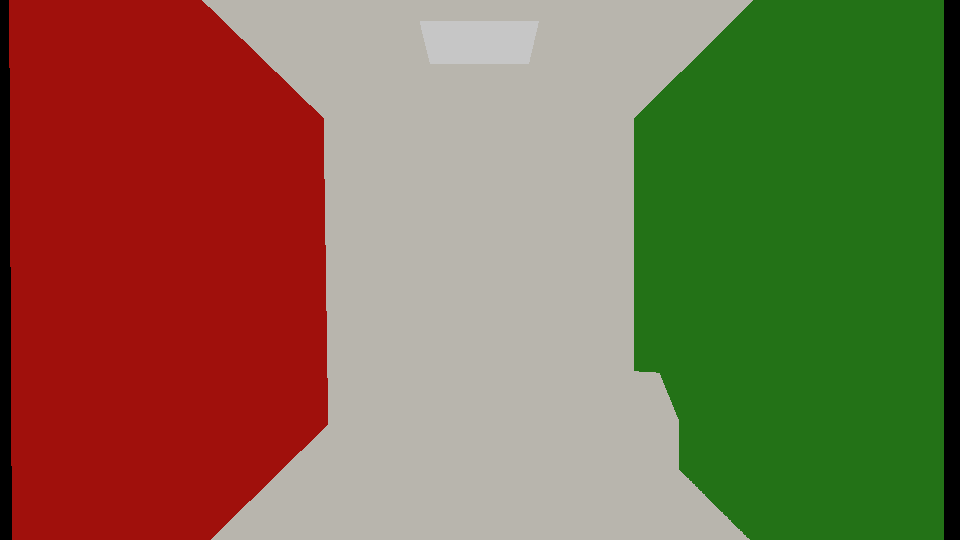
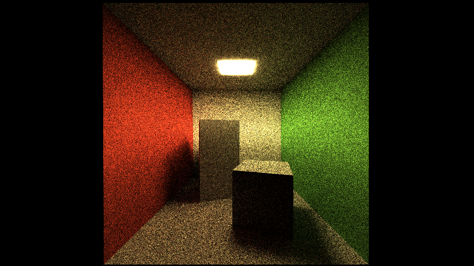

# Computer Graphics 2023

Лабораторные работы по курсу «Компьютерная графика в разработке игр». Здесь собраны три варианта одного рендерера: растеризация и трассировка лучей на CPU, а также отрисовка через DirectX 12.

[](https://github.com/ipipos56/ComputerGraphics2023/actions/workflows/check.yml)


## Примеры рендеров

| Rasterization | Raytracing |
|:---:|:---:|
|  |  |

Cornell Box, 960 × 540. Изображение справа получено с глубиной трассировки 4 и накоплением 512 кадров.

## Что реализовано

**Rasterization**
- загрузка моделей OBJ и материалов MTL;
- перспективная камера, вершинный и пиксельный шейдеры;
- растеризация треугольников с барицентрическими координатами;
- проверка глубины и сохранение результата в PNG.

**Raytracing**
- пересечение лучей с треугольниками по алгоритму Мёллера — Трумборе;
- ограничивающие объёмы AABB для ускорения трассировки;
- диффузное отражение, излучающие материалы и настраиваемая глубина трассировки;
- накопление кадров со смещением лучей и параллельный расчёт через OpenMP;
- сохранение изображения в PNG.

**DirectX 12**
- окно Win32 и интерактивная камера;
- вершинные и индексные буферы, константный буфер и HLSL-шейдеры;
- двойная буферизация, command list и синхронизация через fence.

Во всех вариантах используются общие загрузчик модели, камера и параметры командной строки.

## Сборка

Понадобятся Windows, Git, CMake 3.13 или новее и Visual Studio 2019/2022 с компонентами **Desktop development with C++** и **Windows 10/11 SDK**. OpenMP входит в состав MSVC.

Склонировать репозиторий нужно вместе с подмодулями:

```powershell
git clone --recursive https://github.com/ipipos56/ComputerGraphics2023.git
cd ComputerGraphics2023
```

Если репозиторий уже склонирован без подмодулей:

```powershell
git submodule update --init --recursive
```

Сборка всех трёх исполняемых файлов:

```powershell
cmake -S . -B build -A x64
cmake --build build --config Release
```

Готовые файлы появятся в `build/Release`: `Rasterization.exe`, `Raytracing.exe` и `DirectX12.exe`.

## Запуск

Команды ниже нужно выполнять из корня репозитория: пути к моделям заданы относительно него.

Растеризация куба, который выбран по умолчанию:

```powershell
.\build\Release\Rasterization.exe --result_path rasterization.png
```

Трассировка Cornell Box с глубиной трассировки 3 и накоплением 16 кадров:

```powershell
.\build\Release\Raytracing.exe --model_path models\CornellBox-Original.obj --result_path raytracing.png --width 1280 --height 720 --camera_position 0.0,1.0,2.0 --raytracing_depth 3 --accumulation_num 16
```

Оконный рендерер DirectX 12:

```powershell
.\build\Release\DirectX12.exe --model_path models\cube.obj --width 1280 --height 720
```

Растеризация и трассировка лучей выполняются один раз и сохраняют PNG. DirectX 12 открывает окно и продолжает рендерить сцену до его закрытия.

### Управление в DirectX 12

| Действие | Управление |
|---|---|
| Движение вперёд / назад | `W` / `S` |
| Движение влево / вправо | `A` / `D` |
| Поворот камеры | движение мыши |
| Выход | закрытие окна |

## Параметры командной строки

| Параметр | По умолчанию | Описание |
|---|---:|---|
| `--width` | `1920` | Ширина изображения или окна |
| `--height` | `1080` | Высота изображения или окна |
| `--model_path` | `models/cube.obj` | Путь к OBJ-модели |
| `--camera_position` | `0.0,1.0,2.0` | Положение камеры: `x,y,z` |
| `--camera_theta` | `0.0` | Азимут камеры в градусах |
| `--camera_phi` | `0.0` | Угол наклона камеры в градусах |
| `--camera_angle_of_view` | `60.0` | Поле зрения в градусах |
| `--camera_z_near` | `0.001` | Ближняя плоскость отсечения |
| `--camera_z_far` | `100.0` | Дальняя плоскость отсечения |
| `--result_path` | `result.png` | Файл для сохранения PNG; только CPU-рендереры |
| `--raytracing_depth` | `1` | Максимальная глубина трассировки луча |
| `--accumulation_num` | `1` | Количество накапливаемых кадров |
| `--help` | — | Список всех параметров |

Увеличение `--raytracing_depth` и `--accumulation_num` улучшает картинку, но заметно увеличивает время расчёта.

В каталоге `models` уже лежат куб, Cornell Box, чайник и Sponza. Для собственной модели достаточно передать путь к OBJ через `--model_path`; MTL и текстуры загрузчик ищет рядом с ним.

## Структура проекта

```text
src/
├── renderer/
│   ├── rasterizer/   # растеризация на CPU
│   ├── raytracer/    # трассировка лучей и AABB
│   └── dx12/         # DirectX 12
├── world/            # камера и загрузка OBJ/MTL
├── utils/            # окно Win32 и сохранение PNG
├── main.cpp          # входная точка CPU-рендереров
├── settings.cpp      # параметры командной строки
└── win_main.cpp      # входная точка DirectX 12
shaders/              # HLSL-шейдеры
models/               # модели, материалы и текстуры
libs/                 # сторонние библиотеки
```

## Проверка в GitHub Actions

После каждого push workflow `Check labs` собирает проект на Windows, рендерит несколько тестовых сцен и загружает PNG как артефакты. Отдельно сохраняются `DirectX12.exe`, шейдер и модели.

## Сторонние библиотеки и модели

- [stb](https://github.com/nothings/stb) — чтение текстур и запись PNG, Public Domain / MIT;
- [linalg.h](https://github.com/sgorsten/linalg) — векторы и матрицы, The Unlicense;
- [tinyobjloader](https://github.com/tinyobjloader/tinyobjloader) — загрузка OBJ и MTL, MIT;
- [cxxopts](https://github.com/jarro2783/cxxopts) — разбор аргументов командной строки, MIT;
- [D3DX12](https://github.com/microsoft/DirectX-Graphics-Samples) — вспомогательные структуры DirectX 12.

Модели взяты из набора [G3D Data](https://casual-effects.com/g3d/data10/index.html): Cornell Box и Cube — Morgan McGuire, Sponza — Marko Dabrovic. Чайник — Martin Newell. Информация об авторах и лицензиях также находится в `models/README.md` и `models/copyright.txt`.
